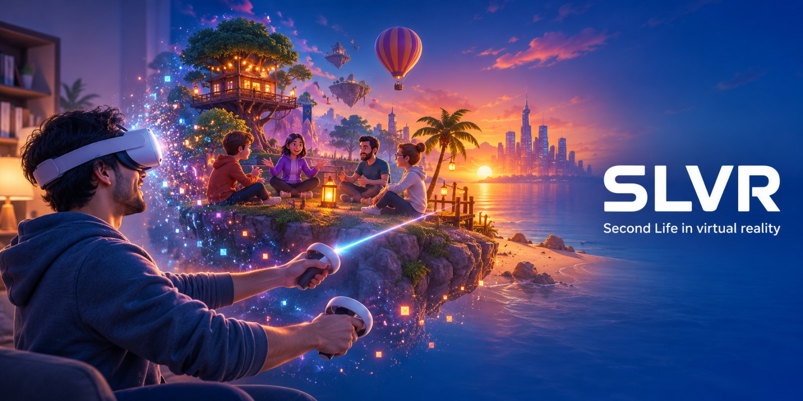

<p align="center"></p>

# SLVR

**Second Life in virtual reality.** SLVR is a Second Life viewer with native OpenXR support,
built on the current Firestorm Viewer. Put on a headset and you see the world from your
avatar's own eyes, in stereo and at true scale. You walk, fly, teleport and chat with your
controllers, and the full viewer interface floats in front of you on a panel you can move.

> [!IMPORTANT]
> SLVR is an independent, experimental project. It is **not affiliated with, endorsed by or
> supported by the Firestorm Project or Linden Lab**. Please do not ask Firestorm support for
> help with SLVR.

This repository holds **source code only**. No builds are published here.

---

## Highlights

- **Native OpenXR.** No SteamVR or OpenVR layer is needed. SLVR runs on any OpenXR runtime
  with OpenGL support. It is developed on Meta Quest 3 through Virtual Desktop.
- **Your avatar's eyes.** You get a first-person view at the avatar's eye height, with head
  tracking and the horizon kept level. An optional mode uses your own body height instead.
- **The whole viewer, in VR.** The full Firestorm interface appears on a curved panel that
  you can carry, resize and place. HUD attachments, pie menus, script dialogs and every
  floater work there.
- **Typing in VR.** A Quest-style on-screen keyboard has word suggestions and next-word
  prediction, and keyboard layouts for 11 languages.
- **Comfort first.** Snap or smooth turning, a comfort vignette, a short blink over jumps,
  recentring, and an option to keep your view steady when a script moves the camera.
- **Made for Second Life.** You get arc teleport, push-to-talk, a camera zoom that follows
  your laser, a chat-only mode and an unread-message indicator.

## Features

### Viewing
- Stereo rendering with per-eye asymmetric projection, straight from the headset's field of
  view.
- First-person view from the avatar's eyes, including while seated. The avatar's own head
  attachments are hidden so they do not block the view.
- Eye height comes from the avatar, or from your own height. Your height can be entered by
  hand or measured with the headset.
- Name tags and floating text are sized for the headset's own field of view.
- An optional lighter-graphics preset for VR (shadows, reflections, depth of field, mirrors
  and draw distance) that takes effect as soon as it is switched. Your saved settings are
  never touched; they come back as soon as the preset or VR is switched off.

### Moving
- **Walking and strafing** with the left stick, and running when the stick is held all the
  way for a moment; a short vibration tells you that you are running. You walk where you
  look, or optionally where your left hand points.
- **Turning** with the right stick, in steps of 15°, 30°, 45° or 90°, or smoothly at an
  adjustable speed.
- **Flying.** Hold the right stick up to take off; push up or down to rise or sink.
- **Arc teleport.** Hold A to aim a falling arc, reaching some 27 metres, and release to go
  there. The arc refuses walls, steep surfaces and places where RLVa does not allow you to go.
- **Recentre.** Hold X to make the way you face now straight ahead.

### Comfort
- A comfort vignette with Off, Low, Medium and High levels. It is triggered by real view
  motion (walking, flying, vehicles, camera moves), not by head movement. It closes as you
  start moving, stays while you move and opens shortly after you stop; rising and sinking
  count less than moving forward.
- A short blink to black over snap turns and teleports.
- A script or seat that takes over the camera does not drag your view around. This can be
  switched off.

### Interface
- The full viewer UI on a panel. It can be curved round you where the runtime supports
  cylinder layers, and it keeps the size and distance you last gave it. It can optionally
  glide back into view when you turn away, not before you look past its edges.
- A laser pointer on each hand. Trigger and grip act as the left and right mouse buttons,
  double-click works, and the laser colour and opacity can be set.
- Haptic ticks as the laser crosses keys and buttons, and a firmer pulse on press.
- A wrist menu: look at your left controller for quick buttons (panel, chat, settings, photo,
  recentre, fly / land / stand up).
- A chat-only mode that shows just the conversation window where it was on the full panel,
  together with any open script dialogs. Drag a window by its title bar to move it anywhere
  around you. A glowing dot shows unread messages (private chats only by default).
- Context and pie menus open where you look; a trigger press beside one closes it.
- With the panel hidden or only the chat shown, the windows you open, alerts from the grid
  (a refused teleport, an ejection) and questions from objects (an attach request) still
  come up in front of you, square on to your eyes, and the keyboard works in them. With the
  chat shown, script dialogs and alerts stack just above the conversation window (or beside
  it when there is no room above) and move with it. Script dialogs come up only from the object you touched, not from a shop greeting
  you as you arrive.
- A left-handed mode that swaps the controllers.
- Your real controllers in your hands: Meta Quest Touch Plus models, textured, from Meta's
  own controller art (see [Controller models](#controller-models)). Without them, simple
  boxes show where your hands are. They can be hidden, leaving only the lasers.
- VR screenshots of what the right eye sees, panel and keyboard included, saved as PNG files
  to `Pictures\SLVR`.

### On-screen keyboard
- A keyboard on its own layer that can be typed with both hands, with a symbols page,
  emoticons, a repeating backspace, shift and caps lock. It comes up when you press a text
  field, low in front of you and tilted back, so you can type with your arms resting.
- Word completion and next-word prediction, learned locally from your own chat logs.
- Swipe typing: hold the right trigger on the first letter and glide over the others; the
  word is typed as you let go, with a fading trail in your laser's colour behind the
  pointer. The next likeliest words are offered in its place. Quick presses always type
  their letter, so fast typing with both hands is not taken for a swipe. It can be switched
  off.
- Layouts for English, Turkish, Azerbaijani, Danish, German, Spanish, French, Italian, Polish,
  Portuguese and Russian.

### Languages
- SLVR's own menus, settings and messages are available in 13 languages: English, Turkish,
  Azerbaijani, Danish, German, Spanish, French, Italian, Polish, Portuguese, Russian,
  Japanese and Chinese.

## Controls

Meta Touch controllers, right-handed. Left-handed mode mirrors the controllers; the menu
button stays on the left.

| Control | Action |
| --- | --- |
| Right trigger | Left click (UI or world); on the keyboard, hold and glide over the letters to swipe a word |
| Right grip | Right click: context and pie menus, opened where you look |
| Right stick left/right | Turn (snap or smooth) |
| Right stick up/down | Jump or crouch; held up, start flying; rise or sink while flying |
| **A** (hold) | Aim the teleport arc; release to teleport |
| **B** | Push to talk (follows your voice settings: hold or toggle) |
| Left stick | Walk and strafe; hold fully to run |
| Left trigger | Type on the keyboard; elsewhere, hold to zoom the camera to what the laser points at, then use the right stick to zoom and orbit |
| Left grip (hold) | Grab the panel; the right stick moves it nearer or further and resizes it |
| **X** (hold) | Recentre |
| **Y** | VR screenshot |
| Menu button | Cycle: full panel, chat only, hidden |
| Look at the left controller | Wrist menu |

To switch VR on or off, use **World > VR Headset** or **Ctrl+Alt+F7**. All options are in
**SLVR > SLVR Settings**.

## Requirements

- Windows 10 or 11, 64-bit.
- A PC VR headset with an OpenXR runtime that supports OpenGL (`XR_KHR_opengl_enable`),
  for example Virtual Desktop (VDXR), Meta Quest Link or SteamVR.
- Meta Touch-style controllers.
- A capable GPU: Second Life renders every frame twice in VR. Development uses an RTX 3060
  Laptop GPU.

## Controller models

The controller models belong to Meta and are not part of this repository. To see them in VR:

1. Download **Meta Quest Hardware Art** from
   [Meta's developer site](https://developers.meta.com/vr/downloads/package/oculus-controller-art/)
   and unpack it.
2. Run the converter, which needs only Python 3:
   ```
   python scripts/slvr/convert_controller_models.py <unpacked folder>
   ```
   It writes the Touch Plus models into `%APPDATA%\SLVR_x64\user_settings\vr_controllers`.
   SLVR picks them up the next time VR starts.

Meta allows the art to be used to show the matching controller in a VR application. See
the attribution file in the package.

## Building

SLVR builds exactly like Firestorm. The steps are in [doc/building_windows.md](doc/building_windows.md).
The differences:

- Use the `ReleaseFS_open` configuration.
- Configure with `-DUSE_OPENXR:BOOL=ON`. The OpenXR loader (1.1.40, static) is fetched by
  autobuild.
- An OpenSim build (`-DOPENSIM:BOOL=ON -DHAVOK_TPV:BOOL=OFF`) avoids the private Havok
  package.

```
autobuild configure -c ReleaseFS_open -A64 -- -DOPENSIM:BOOL=ON -DHAVOK_TPV:BOOL=OFF -DUSE_OPENXR:BOOL=ON
autobuild build -c ReleaseFS_open -A64 --no-configure
```

The VR code lives in `indra/newview`:

- `llviewerVR.*`: the VR session, input and UI.
- `llvrbackend*`: OpenXR.
- `llvrkeyboard.*`: the on-screen keyboard.
- `llvrlanguage.*`: languages and the settings window.

## Status

SLVR is under active development and tested on a Meta Quest 3. Every version is tested in
the headset before the next one builds on it.

| Version | What it added |
| --- | --- |
| 0.6.7 | Keyboard nearer and more upright, dialogs beside the chat when there is no room above, settings beside the chat on the full panel, the panel follows only once you look past its edge |
| 0.6.6 | Dialogs and alerts stack above the chat window, shop dialogs stay out of the hidden panel, windows on a hidden panel follow you, the keyboard sits higher, a wider default panel distance, swipe typing that leaves quick presses alone |
| 0.6.5 | Alerts and object questions over a hidden panel, menus and dialogs square on to the eyes, keyboard in windows opened over a hidden panel, settings alone from the keyboard too |
| 0.6.4 | Keyboard comes up on text fields again, windows carried round you by their title bar, panel follows sooner, longer teleport, settings alone from the wrist menu |
| 0.6.3 | Swipe typing on the keyboard; pie menu slices take the laser to their edge |
| 0.6.2 | Keyboard only on text fields and at the waist, chat window stays put and moves in space, steadier vignette, menus where you look, longer teleport, clearer running, instant lighter-graphics switch |
| 0.6.1 | Meta Quest Touch Plus controller models, with an option to hide the controllers |
| 0.6.0 | Arc teleport, push-to-talk, recentring, running, haptics, wrist menu, curved panel, left-handed mode, own-height mode, script camera guard, VR text scale, lighter VR graphics, two-column settings |
| 0.5.5 | Smooth turning, comfort vignette, laser colour and opacity |
| 0.5.4 | See-through HUDs; panel, dialogs and keyboard open where you look |
| 0.5.0 – 0.5.3 | SLVR menu and settings in 13 languages, keyboard layouts, next-word prediction, VR screenshots, script dialogs on a hidden panel |
| 0.4.0 | Quest-style keyboard on its own layer, word suggestions, chat-only mode, message dot |
| 0.3.x | First-person view, movable panel, HUDs, double click, flying, camera zoom, steadier laser |
| 0.2.0 | Touch controllers, laser pointer, UI panel |
| 0.1.0 | Stereo rendering and head tracking over OpenXR |

Planned next: video recording in VR and voice dictation for the keyboard.

## Credits and licence

- Based on [Firestorm Viewer](https://github.com/FirestormViewer/phoenix-firestorm), itself
  derived from the [Second Life viewer](https://github.com/secondlife/viewer) by Linden Lab.
- The VR approach follows the [P373R VR Mod](https://github.com/humbletim/p373r-vrmod),
  rewritten for OpenXR.
- Licensed under the GNU Lesser General Public License 2.1, like the viewer it is based on.
  See [LICENSE](LICENSE) and `doc/LICENSE-source.txt`.

SLVR follows Linden Lab's Third Party Viewer Policy. Second Life is a trademark of Linden
Research, Inc. Meta Quest is a trademark of Meta Platforms, Inc. SLVR is not affiliated with
either company.
